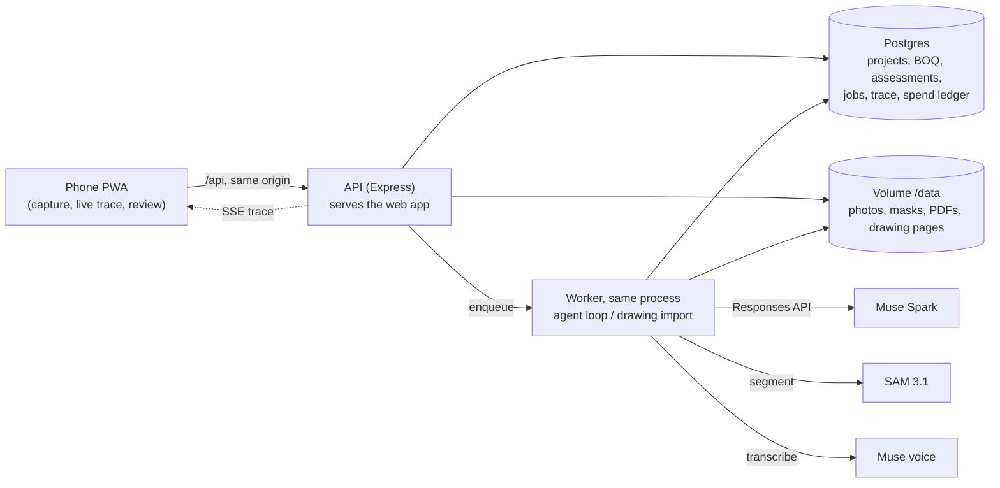

# SiteSight

Phone photos + a BOQ in, a bill-ready progress report out: an agent built on Muse Spark and SAM 3.1 measures
construction progress per BOQ item, with evidence an engineer can check.

**Problem.** Small contractors track progress through WhatsApp photos and Excel BOQs. Running bills are argued line by
line because nobody can show how much of an item is actually built. Enterprise progress tools need 360° cameras, BIM
models and site scanning that a G+2 residential job doesn't have.

## Demo

- **Live:** https://sitesightapi-production.up.railway.app (password in the submission form)
- **Video:** _link to be added_

## How it works

1. **Drawings → BOQ.** Upload the drawing PDF. Muse Spark sorts the sheets, reads the structural ones (column and
   footing schedules, layouts, slab plans), and code assembles the BOQ. Quantities the drawings don't state, or where a
   schedule and a layout disagree, are marked "needs input" for the engineer. (A spreadsheet BOQ works too.)
2. **Phone photos.** The site engineer photographs each zone from the PWA, optionally with a voice note.
3. **SAM 3.1 segments** columns and brickwork in each photo.
4. **Muse Spark verifies every detection** against the photo and rejects scaffolding poles, rebar cages, duplicates and
   neighbouring buildings, then **measures** (counts, the built share of each wall bay) and **assigns stages** for
   staged items (slab: shuttering → reinforcement → concreting).
5. **When unsure, it asks for a specific photo** ("square-on photo of the bay between C3 and C4, including the beam
   above"), and resumes when it arrives.
6. **The engineer reviews**: masks drawn on each evidence photo, accept / edit / undo.
7. **PDF report**, ready for billing: observed quantities are billable; inferred ones are listed separately and not.

## Meta stack

| Model | What it does in SiteSight | Why it matters |
|---|---|---|
| **Muse Spark** (`muse-spark-1.3`, Responses API, tool calling) | Runs the agent loop: views photos, verifies SAM detections, decides stages, writes rationales, requests photos. Also reads drawing sheets into a strict JSON schema and parses spreadsheet BOQs. | One model handles vision, judgement and tool use; strict JSON + retry keeps its output machine-checkable. |
| **SAM 3.1** (text-prompted segmentation) | Finds every column and brick wall instance in a photo, with masks and scores. | Turns "looks about half done" into countable instances and measurable areas. |
| **Muse voice transcription** (`muse-voice-transcribe-1.0`) | Transcribes the engineer's voice note attached to a photo; the agent reads it as context. | Engineers on site talk faster than they type. |

## Architecture



One Railway service runs migrations, the API, the built web app and the job worker in one Node process, with Railway
Postgres and a volume. See [DEPLOY.md](DEPLOY.md).

## Design decisions

- **Verify before measure.** Every SAM detection must be kept or rejected by Muse Spark, with a reason, before
  `measure` will use it. Low-score keeps need a specific visual reason; duplicates are rejected.
- **Code does the arithmetic, not the model.** The model picks a stage or measures a bay; code turns stage weights and
  bay fractions into percent and quantity, caps them at the planned quantity, and flags progress that goes backwards
  as a deviation.
- **Staged progress.** Items like slabs track the latest completed stage (shuttering 25 / reinforcement 35 /
  concreting 40) instead of a guessed percentage.
- **Observed vs inferred billing.** Hidden earlier work (footings under a cast plinth beam) can be recorded as
  inferred, citing the observed later item. It is capped at 0.5 confidence and never billed until seen.
- **Image-context compaction.** At most 3 images stay in the conversation; once a photo is verified its image is
  replaced by a text summary of the decisions. Long runs stay inside context and cost.
- **Cost caps.** Per visit ($1.50), per drawing import ($1.00), and a daily cap ($5) read from an append-only spend
  ledger that survives project deletion. SAM requests are reserved before they're sent, so concurrent requests can't
  overshoot.
- **Ask-back dedupe.** One open photo request per item per project; asking again returns the existing request, and a
  photo from today's visit can answer last week's request.

## Evaluation

`pnpm eval` runs labelled cases ([samples/eval/cases.json](samples/eval/cases.json)) through the real agent (photo
cases, in-memory database) and the drawing import (drawing cases), and scores: stage exact-match, count within
tolerance, evidence basis, drawing totals; how many SAM detections the agent rejected and whether the labelled false
positives (e.g. "rebar cages are not cast columns") were among them; consistency across `--runs`; cost and latency.
Spend is hard-capped by `--max-cost`.

| Metric | Result |
|---|---|
| Stage, exact match | _to fill from `pnpm eval --runs 3`_ |
| Count within tolerance | |
| Evidence basis correct | |
| Drawing import checks | |
| False detections caught (labelled) | |
| SAM detections rejected by the agent | |
| Same answer across runs | |
| Cost per run (avg) | |
| Latency per run (avg) | |

## Limitations

- **Perspective in panel measurement.** A bay's built share is measured in image pixels; a photo taken at an angle
  over- or under-states the far side. The agent is told to request square-on photos, but it isn't corrected for.
- **SAM is weak on rebar and slabs**, so those are judged visually by Muse Spark (confidence capped at 0.7), not
  segmented.
- **Inferred items** are a judgement call; they are kept out of the bill, but the engineer still has to confirm them.
- **Single replica.** The volume and the in-process worker tie the deployment to one instance (fine for a demo, not
  for many concurrent sites).

## Roadmap

- WhatsApp intake: forward site photos to a number instead of opening the app.
- Hindi and Marathi voice notes.
- Rate-based billing: BOQ rates × measured quantities → the running bill itself.
- Multi-floor projects: zones per floor, with floor-aware drawing import and progress views.

## Run it locally

```sh
pnpm install
cp .env.example .env      # META_API_KEY, META_BASE_URL, prices; STORAGE_LOCAL_DIR=samples/out/storage
pnpm db:migrate           # needs a Postgres DATABASE_URL
pnpm dev:api              # http://localhost:8787
pnpm dev:worker           # in a second terminal
pnpm dev:web              # in a third: http://localhost:5173
```

More (phone testing, dry runs, drawing import CLI, eval): [DEVELOPMENT.md](DEVELOPMENT.md).
Deployment: [DEPLOY.md](DEPLOY.md). Full design: [DESIGN.md](DESIGN.md).

## Lessons learned

- **Muse Spark wasn't available from Railway's EU West region**: every call returned `404 The requested model was not
  found`, while the same key and model worked from India. Moving the service and database to US East fixed it.
- **SAM prompt wording matters.** "exposed brick wall" finds walls that a plain "brick wall" prompt misses, so
  brickwork runs two prompt variants ("exposed brick wall", "brickwork") and merges overlapping masks by IoU.
